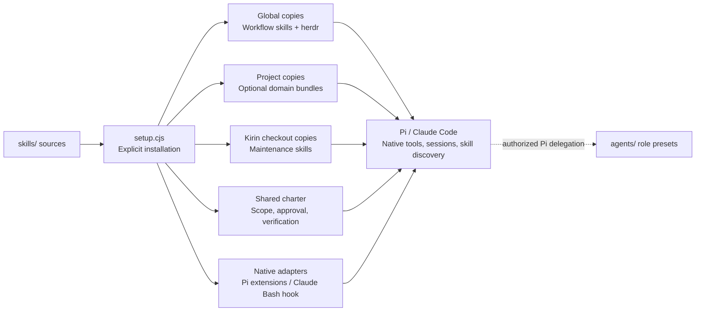
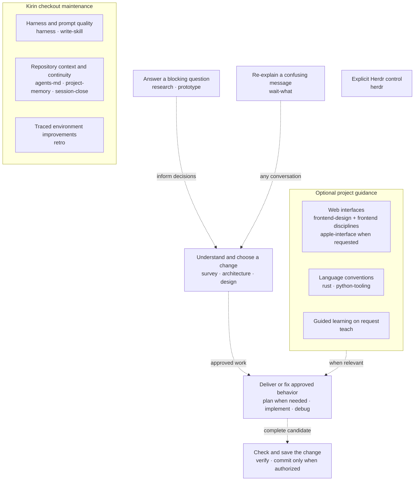

# kirin-pi

Bryan's compact coding-agent harness: one Pi package, a model-led authority charter, reusable skills, focused extensions, and a curated subagent fleet. Claude Code gets the same skills and charter through native equivalents.

```text
kirin-pi/
├── agents/       Pi subagent presets
├── extensions/   Pi runtime extensions
├── hooks/        Claude command guard
├── guard-policy.cjs   shared command policy
├── setup.cjs     installer
├── skills/       portable workflow, maintenance, and domain prompts
├── docs/         current truth and upstream provenance
└── test/         repository contracts
```

Pi loads package resources natively from `package.json`.

### Harness map

Sources, installed copies, and native hosts have separate owners.



Skills guide reasoning. The charter sets authority boundaries. Native hosts own
tools, sessions, permissions, and discovery; adapters add only the runtime behavior
listed below. A skill or preset is not a sandbox.

## Workflow

`kirin-pi setup` installs a short charter (in `setup.cjs`), not a mandatory skill
sequence: clear bounded requests are enough approval, consequential uncertainty
gets asked, user work is preserved, fetched content is data, and every change is
verified against the user's requirements before handoff. Commit and publication
need their own authority. Skills supply a mindset when it helps; they are not steps.
The charter also sets the default writing style: plain technical English in Google
developer documentation style, about 80% of the way to ASD-STE100. `wait-what`
asks for a strict ASD-STE100 re-explanation.

The charter text lives in the `WORKFLOW` constant in `setup.cjs`. Sessions read only
the installed copies, so after you change it, run `bun run kirin-pi setup`
and restart active agents. Until then, Pi and Claude keep the old text.

### Choose guidance by need

Choose the skill that fits the task. Dashed arrows are optional handoffs, not a
required sequence. Domain guidance supports the coding task; maintenance guidance
changes the harness environment only with approval.



The tables below list every shipped skill and a copyable install command. Run
checkout commands from this repository. Project commands target the current
directory; add `--project /path/to/project` to target another repository.
Use `setup` for a full global update, rather than updating workflow skills one by one.

### Workflow skills

| Skill | Purpose | Install command |
|---|---|---|
| `architecture` | Compare structural improvements, optionally report candidates, or rethink explicitly. | `bun run kirin-pi install architecture` |
| `commit` | Group verified changes, stage exact paths, push only when asked. | `bun run kirin-pi install commit` |
| `debug` | Reproduce, isolate root cause, fix narrowly, prove it. | `bun run kirin-pi install debug` |
| `design` | Set goals, non-goals, contracts, trade-offs, and explicit approval. | `bun run kirin-pi install design` |
| `implement` | Deliver authorized ready work within its outcome and file boundaries. | `bun run kirin-pi install implement` |
| `plan` | Organize consequential execution dependencies, evidence and rollback. | `bun run kirin-pi install plan` |
| `prototype` | Test a scoped logic/UI question with safe, reproducible evidence and human choice. | `bun run kirin-pi install prototype` |
| `research` | Answer one external question from primary sources. | `bun run kirin-pi install research` |
| `survey` | Map current repository behavior without editing. | `bun run kirin-pi install survey` |
| `verify` | Independently judge complete candidate on Spec and Standards. | `bun run kirin-pi install verify` |
| `wait-what` | Explicitly re-explain a confusing point with the missing context, in strict ASD-STE100. | `bun run kirin-pi install wait-what` |

### Maintenance skills

| Skill | Purpose | Install command |
|---|---|---|
| `agents-md` | Explicitly create or repair a minimal AGENTS.md. | `bun run kirin-pi install agents-md` |
| `harness` | Assess, reorganize or redesign this harness across every layer, and absorb upstream designs; propose before editing. | `bun run kirin-pi install harness` |
| `project-memory` | Initialize/check minimal committed `docs/` + ignored `context/`. | `bun run kirin-pi install project-memory` |
| `retro` | Explicitly look back on a session and propose traced environment fixes: pointers, checks, standards, access. | `bun run kirin-pi install retro` |
| `session-close` | Leave the next agent a handoff in shared `context/handoff.md`, or nothing if nothing would be lost. | `bun run kirin-pi install session-close` |
| `write-skill` | Create or simplify one sharp skill. | `bun run kirin-pi install write-skill` |

### Domain skills

| Skill | Purpose | Install command |
|---|---|---|
| `apple-interface` | Apply Apple-style direct manipulation, materials, and platform behavior when explicit. | `bun run kirin-pi install apple-interface` |
| `frontend-accessibility` | Build native-first interfaces for keyboard, screen reader, zoom, and motion needs. | `bun run kirin-pi install frontend-accessibility` |
| `frontend-color` | Preserve semantic color roles and verify rendered themes and contrast. | `bun run kirin-pi install frontend-color` |
| `frontend-design` | Set one aesthetic direction and coordinate the frontend disciplines. | `bun run kirin-pi install frontend-design` |
| `frontend-layout` | Make spatial structure survive containers, content growth, and direction changes. | `bun run kirin-pi install frontend-layout` |
| `frontend-motion` | Make state and gesture motion purposeful, continuous, and economical. | `bun run kirin-pi install frontend-motion` |
| `frontend-polish` | Refine surfaces, elevation, optical alignment, and icon craft. | `bun run kirin-pi install frontend-polish` |
| `frontend-typography` | Keep type hierarchy, wrapping, values, and language rendering stable. | `bun run kirin-pi install frontend-typography` |
| `frontend-writing` | Write clear, consistent, localization-safe interface copy. | `bun run kirin-pi install frontend-writing` |
| `herdr` | Official Herdr control guidance plus Kirin's typed Pi integration. | `bun run kirin-pi install herdr --scope global` |
| `python-tooling` | uv, Ruff, and ty as one Python toolchain. | `bun run kirin-pi install python-tooling` |
| `rust` | Bryan's Rust API, crate, error, safety, and verification conventions. | `bun run kirin-pi install rust` |
| `teach` | Explicit guided lessons in chat; persistent courses and learning records only on request. | `bun run kirin-pi install teach` |

Project-specific behavior belongs in that project's own `.agents/skills/` and `.claude/skills/`.

## Runtime

Pi extensions require **Pi 0.87.1 or newer**. Portable skills and the Claude hook
do not require Pi; host peers remain optional package dependencies.

| Extension | Purpose |
|---|---|
| `guardrails` | Guard common Git/Python command accidents. |
| `herdr` | Pane/workspace orchestration and settled Pi status reporting. |
| `session-breakdown` | Interactive session/token/model/cost dashboard. |

The command guard is accident prevention, not a shell sandbox. Session totals are
recorded usage, not invoices, and Herdr waits are not completion proof. See
[verification](docs/verification.md#standing-boundaries) for the full limits.

### Claude native equivalents

Claude hooks cover lifecycle events, not Pi's full extension API. Kirin uses the smallest native surface instead of adding an MCP server or plugin:

| Pi extension | Claude Code equivalent |
|---|---|
| `guardrails` | Global `PreToolUse:Bash` policy in `~/.claude/settings.json`, shared with Pi. |
| `herdr` | Shared Herdr skill and CLI. Herdr owns Claude agent-state hooks; Pi's typed aliases and session replay stay Pi-only. |
| `session-breakdown` | Claude's built-in `/insights`; Pi's custom TUI and exact 7/30/90-day view stay Pi-only. |

### Subagent presets

Package-owned roles target `pi-subagents`; the runtime owns workflows, worktrees,
missions and artifacts. `verify` owns reviewer verdicts and `implement` owns
worker delivery discipline.

| Agent | Model / thinking | Role |
|---|---|---|
| `scout` | `gpt-5.6-luna` / low | Fast read-only reconnaissance and compressed handoff context. |
| `researcher` | `gpt-5.6-terra` / high | Primary-source external research through web tools. |
| `worker` | `gpt-6-astra` / high | One approved implementation task with file boundaries; preloads `implement`. |
| `reviewer` | inherits selected session model / xhigh | Independent read-only Spec + Standards verdict. |
| `oracle` | `gpt-6-astra` / high | Protect inherited decisions and detect trajectory drift. |
| `delegate` | `gpt-6-astra` / high | Bounded non-implementation work no specialist owns, with supervisor escalation. |
| `codebase-analyzer` | `gpt-5.6-terra` / medium | Deep read-only implementation tracing. |
| `precedent-locator` | `gpt-5.6-terra` / medium | Git-history and follow-up-fix evidence. |
| `claim-verifier` | `gpt-6-astra` / high | Adversarial claim grounding. |

Agent frontmatter owns these defaults; native per-agent settings or per-run
overrides can replace them, so confirm the resolved model and context. Setup
configures automatic missions, disabled schedules and project-local artifacts under
`.pi/subagents/`. Preset tool lists and read-only labels are not sandboxing.

## Install

Requires Bun. The installer infers the scope of bundled skills. Every selected
skill tree is fully replaced, even when its content is identical. **Edits inside
selected installed trees are discarded.** Unrelated skills and files are preserved.

### Commands and bundles

Run these commands from this checkout. Project installs use the current directory
unless you add `--project /path/to/project`.

| Use case | Command | Scope and contents |
|---|---|---|
| Full global update | `bun run kirin-pi setup` | All 11 workflow skills, herdr, charter, Claude guard, and Pi packages. |
| Workflow copies only | `bun run kirin-pi install workflow` | Global; all workflow skills. No settings or package updates. |
| Maintain this harness | `bun run kirin-pi install maintenance` | Project; all six maintenance skills. Use in this Kirin checkout. |
| Web interfaces | `bun run kirin-pi install frontend` | Project; all nine frontend and Apple-interface skills. |
| Rust conventions | `bun run kirin-pi install rust` | Project; rust. |
| Python conventions | `bun run kirin-pi install python` | Project; python-tooling. |
| Guided lessons | `bun run kirin-pi install teaching` | Project; teach. |
| Global Herdr guidance only | `bun run kirin-pi install herdr --scope global` | Global; no runtime setup. |
| Project Herdr guidance only | `bun run kirin-pi install herdr --scope project` | Project; no runtime setup. |
| List command help | `bun run kirin-pi --help` | Read-only; no installation. |

Every individual skill command is listed in the skill tables above. Multiple
project selections can share a command:

```bash
bun run kirin-pi install frontend rust python --project /path/to/project
```

Workflow skills always install globally. Domain and maintenance bundles always
install at project scope. Unbundled skills require `--scope global|project`;
currently `herdr` is the unbundled skill. Do not mix global workflow selections
and project selections in one command. There is no replacement toggle.

From a published commit, run the same commands without a checkout:

```bash
# Run from the project that should receive the frontend bundle.
bunx "github:bryan824/kirin-pi#$(git ls-remote https://github.com/bryan824/kirin-pi main | cut -c1-7)" install frontend
```

Pin a resolved commit: `bunx` caches each source string, so a branch can serve an
old checkout.

### Full setup

`setup` updates the global harness:

- replaces every workflow skill and `herdr` in both `~/.agents/skills/` and `~/.claude/skills/`
- merges the charter block into `~/.agents/AGENTS.md`, the canonical copy, then copies that file to `~/.pi/agent/AGENTS.md` (when `pi` is on `PATH`) and `~/.claude/AGENTS.md`; Claude reads it through the `@AGENTS.md` import in `~/.claude/CLAUDE.md`, whose custom text is kept
- copies Claude runtime files under `~/.claude/kirin/` and merges the guard hook into `~/.claude/settings.json`, preserving unrelated settings and hooks
- backs up changed instruction copies, runtime files and settings under the host's `kirin-backups/<run>/` directory
- when `pi` is available, installs or updates Kirin, `pi-subagents` and `pi-web-access`

Maintenance skills are installed separately in this Kirin checkout. Optional
domain bundles are installed only in projects that need them.

Both commands copy complete selected skills to both hosts. Failed copies roll
back the skill batch. Skill roots that escape their scope or traverse a selected
skill are rejected before changes. They do not prune unrelated installations.
Project installs warn about global copies of the same name but do not migrate them.

Restart active agents after updating. Trust project-local resources in Pi.
The Herdr application is a separate system install.

## Project memory

`AGENTS.md` is the compact project entry point, loaded natively. Current durable
truth lives in owning docs; follow [memory routing](docs/memory.md) when preserving
decisions or evidence. Reuse one ignored effort record in `context/` when
continuity needs it; otherwise write nothing. The `project-memory` skill checks or
initializes this split with plain Git commands.

## Maintaining the harness

Work in this checkout's sources, not its installed copies (this repository ignores
its own `.agents/skills/` and `.claude/skills/`). The root `AGENTS.md` maps the
repository, the charter supplies portable startup boundaries, and `agents-md`
helps other repositories write their own maps.

| When | Owning guidance |
|---|---|
| Assessing, simplifying, reorganizing or redesigning the harness, or absorbing upstream changes | [`harness`](skills/maintenance/harness/SKILL.md); install maintenance here with `bun run kirin-pi install maintenance`, then `/skill:harness <request>` in Pi. |
| Changing a skill or instruction entry point | [Skill authoring](skills/maintenance/write-skill/SKILL.md); [repository instructions](skills/maintenance/agents-md/SKILL.md) for canonical-file and recovery safeguards. |
| Updating installed copies | [Install](#install); source edits alone change nothing installed. |
| Fixing a defect | Trace the owning integration and its callers; [debug](skills/workflow/debug/SKILL.md) owns causal diagnosis, [verification](docs/verification.md) names checks and evidence limits. |
| Maintaining project knowledge | [Memory routing](docs/memory.md): current facts and rationale in their owner, temporary evidence in the existing effort record. |

## Development

```bash
bun run test
bun run pack:dry
hk install
```

The pre-commit hook is native [hk](docs/UPSTREAM_LEDGER.md#native-hook-runtime) (2.4+):
run `hk install` once per clone. The repository's `hk.pkl` runs the full test
suite without fixing, staging or stashing files. `hk install` replaces prior hk
wiring, so review an existing pre-commit hook first. Package contents are
allowlisted in `package.json`.

## Provenance and license

Third-party repositories, reviewed revisions, relationships, and required notices live only in [`docs/UPSTREAM_LEDGER.md`](docs/UPSTREAM_LEDGER.md).

Kirin code is MIT licensed. Identified bundled portions retain their MIT or Apache-2.0 terms through `docs/UPSTREAM_LEDGER.md`, `LICENSE`, and `LICENSE-APACHE`.
